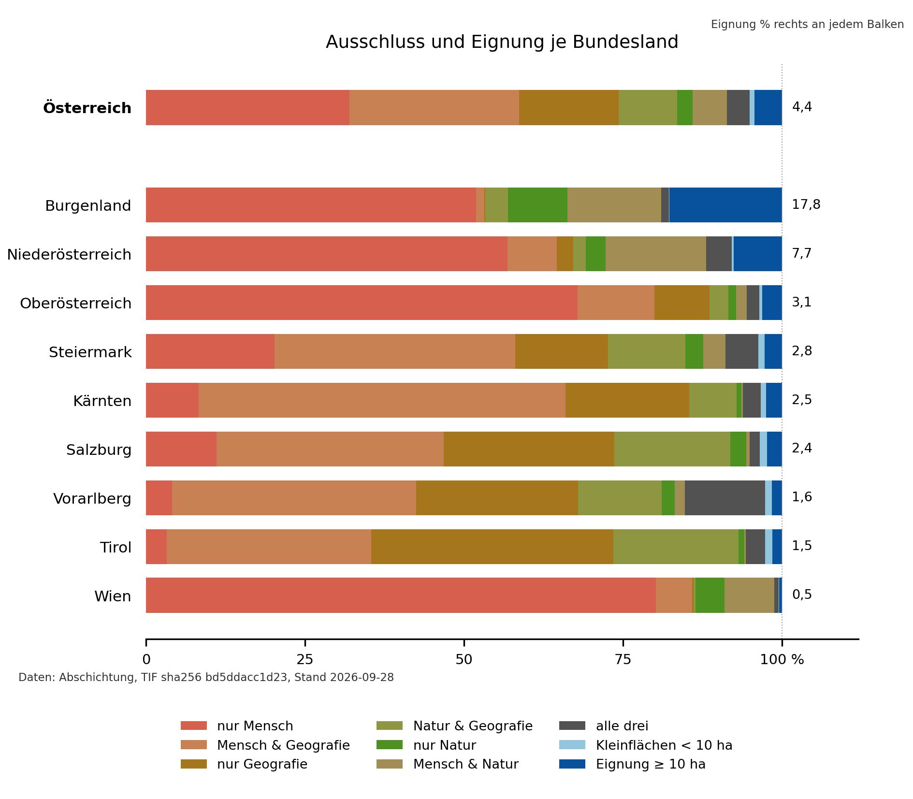

# Methoden: Abschichtung Windkraft Österreich

Die Abschichtung zeigt, welche Flächen in Österreich nach einheitlichen Ausschlusskriterien für Windkraft in Frage kommen. Kurzfassungen stehen in ganzen Sätzen, Details als Stichpunkte.

## 1. Ziel und Prinzip

Die Abschichtung beantwortet die Frage, welche Flächen in Österreich nach einheitlichen Ausschlusskriterien überhaupt für Windkraft in Frage kommen. Alle Ausschlussflächen werden übereinandergelegt. Was übrig bleibt und zusammenhängend mindestens 10 ha groß ist, gilt als Eignungsfläche.

- Ein bundesweit einheitliches Kriterienset; die Regeln der Länder weichen voneinander ab
- Drei Gruppen von Ausschlüssen: **Mensch**, **Natur**, **Geografie**
- Grundlage sind amtliche Daten, ergänzt um OpenStreetMap
- Nicht geleistet: keine Prüfung einzelner Standorte, keine Genehmigungsgrundlage. Nicht berücksichtigt sind Artenschutz im Einzelfall, Schall und Schattenwurf, Netzanschluss, Verfügbarkeit der Grundstücke und Wirtschaftlichkeit

**Abb. 1:** Ausschlussflächen je Gruppe (oben: Mensch, Natur, Geografie) und verbleibende Eignungsfläche ≥ 10 ha (unten, blau).

**Abb. 2:** Anteil der Ausschlussgruppen und der Eignungsfläche je Bundesland. Überschneidungen zweier oder aller drei Gruppen sind schräg gestreift in den beteiligten Farben.

## 2. Überblick: Kategorien und Datenquellen

Jede Gruppe von Ausschlüssen besteht aus mehreren Kriterien, die sich auf eine oder mehrere Datenquellen stützen. Amtliche Daten haben Vorrang; OpenStreetMap ergänzt dort, wo es keine flächendeckenden amtlichen Daten gibt.

**Arten von Datenquellen**

- **Amtlich, Länder:** Flächenwidmungspläne der neun Länder [8–16], Mindestabstandszonen des Landes Niederösterreich [17]
- **Amtlich, Bund:** Kataster [6], Adressregister [4], Verwaltungsgrenzen [5] und Geländemodell, nämlich das Höhenraster 25 m, das aus dem 5-m-Raster des photogrammetrisch erfassten Geländemodells (zuletzt 2020 aktualisiert) abgeleitet ist [1] (alle Bundesamt für Eich- und Vermessungswesen, BEV); Schutzgebiete (Umweltbundesamt) [7]
- **Offen:** OpenStreetMap, eine frei bearbeitbare Weltkarte (Abzug vom 30.03.2026) [3]
- **Modell:** Global Wind Atlas, ein weltweites Windmodell der Technischen Universität Dänemark und der Weltbank [2]

**Kriterien und Quellen**

| Gruppe | Kriterium | Regel | amtlich | OpenStreetMap | Modell |
| --- | --- | --- | --- | --- | --- |
| Mensch | Siedlung | 1 000 m Abstand (NÖ 1 200 m) | Flächenwidmung | – | – |
| Mensch | Häuser im Grünen | 750 m Abstand | Flächenwidmung, Kataster, Adressregister, NÖ-Mindestabstandszonen | – | – |
| Mensch | Gebäude | 25 m Abstand (Seilbahnstationen 50 m) | Kataster | Gebäude | – |
| Mensch | Verkehr | 150 m Abstand | – | Straßen, Bahnen, Seilbahnen | – |
| Mensch | Militär | ohne Abstand | – | Militärflächen | – |
| Mensch | Luftfahrt | Flughafenareal und Anflugkorridore | – | Flughäfen | – |
| Natur | Schutzgebiete | per Verordnung oder Bescheid, ohne Abstand | Umweltbundesamt | nur zur Information | – |
| Geografie | Hangneigung | steiler als 15° | Höhenraster 25 m des BEV [1] | – | – |
| Geografie | Seehöhe | über 2 500 m | Höhenraster 25 m des BEV [1] | – | – |
| Geografie | Wind | unter 150 W/m² in 130 m Höhe | – | – | Global Wind Atlas |
| Geografie | Gewässer | ab 1 ha | – | Gewässer | – |

**Gemeinsame Rechenbasis**

- Ganz Österreich wird in ein Raster aus quadratischen Zellen von 25 × 25 m zerlegt (Koordinatensystem MGI / Austria Lambert, EPSG:31287). Das Raster ist dasselbe wie das des amtlichen Geländemodells, des Höhenrasters 25 m des BEV [1]. Dieses ist aus dem 5-m-Standardraster des photogrammetrisch erfassten Geländemodells (zuletzt 2020 aktualisiert) interpoliert.
- Eine Zelle gilt als Teil einer Fläche, sobald die Fläche sie auch nur teilweise berührt.
- Ein Abstand wird als Kreis mit dem jeweiligen Radius um jede betroffene Zelle gelegt. Durch das Raster fallen Abstände um bis zu rund 18 m größer aus als der Nennwert.
- Jedes Kriterium wird als eigene Ebene gespeichert; alle Ebenen liegen in einer gemeinsamen Rasterdatei (GeoTIFF).

## 3. Ausschlusskriterien

Jedes Kriterium ist gleich aufgebaut: **Kurzfassung**, dann **Daten**, dann **Berechnung**.

### 3.1 Mensch

Abstände zu Orten, an denen Menschen wohnen, und zu Gebäuden und Infrastruktur.

#### 3.1.1 Siedlung

**Kurzfassung.** Um gewidmetes Wohn-, Misch-, Kern- und Dorfgebiet gilt ein Abstand von 1 000 m, in Niederösterreich von 1 200 m. Der niederösterreichische Wert folgt dem Mindestabstand zu gewidmetem Wohnbauland im Sektoralen Raumordnungsprogramm über die Windkraftnutzung des Landes [17]. Grundlage ist die Flächenwidmung aller neun Länder; Industrie- und Betriebsgebiete zählen nicht als Siedlung.

**Daten**

Für jedes Land wird dessen eigener Flächenwidmungsplan verwendet, wie ihn das Land als offene Daten bereitstellt. Die Länder benennen ihre Widmungen unterschiedlich; die Tabelle zeigt, welche Widmungen jeweils als Siedlung gewertet werden.

| Land | Quelle (Portal) | Stand | als Siedlung gewertet |
| --- | --- | --- | --- |
| Burgenland | Land Burgenland, offene Daten [8] | 22.06.2026 | Wohngebiet, Dorfgebiet, Geschäftsgebiet, gemischtes Baugebiet, Aufschließungsgebiete, Gebiete für förderbaren Wohnbau |
| Kärnten | Land Kärnten, KAGIS [9] | 12.07.2026 | Wohngebiet, reines Wohngebiet, Dorfgebiet, gemischtes Baugebiet, Geschäftsgebiet, Kurgebiet, reines Kurgebiet |
| Niederösterreich | Land Niederösterreich, NÖ Atlas [10] | 10.07.2026 | Wohnbauland laut Widmungshülle (Codes SBL und SBLNB) |
| Oberösterreich | Land Oberösterreich, DORIS [11] | 10.07.2026 | Wohngebiete und Mischgebiete |
| Salzburg | Land Salzburg, SAGIS [12] | 12.07.2026 | Bauland für Wohn-, Dorf- und Kerngebiete (Codes BAEW, BADG, BARW, BAKG, BALK, BAZG, BAFW) |
| Steiermark | Land Steiermark, offene Daten [13] | 10.07.2026 | Bauland mit Wohn- oder gemischter Nutzung |
| Tirol | Land Tirol, tiris [14] | 12.07.2026 | Wohngebiet, gemischtes Wohngebiet, Kerngebiet, allgemeines und landwirtschaftliches Mischgebiet |
| Vorarlberg | Land Vorarlberg, VoGIS [15] | 12.07.2026 | Baufläche und Bauerwartungsfläche für Wohn-, Misch- und Kerngebiet |
| Wien | Stadt Wien, offene Daten [16] | 29.07.2026 | Wohngebiet, gemischtes Baugebiet (ohne Betriebsbaugebiet); nur der vereinfachte Widmungsplan ist offen verfügbar |

- Nicht als Siedlung gewertet:
  - Industrie-, Betriebs- und Gewerbegebiete
  - Hofstellen, Campingplätze, Golfplätze, Kleingärten, Auffüllungsgebiete, Ferienhaus- und Tourismusgebiete. Diese Flächen fallen unter „Häuser im Grünen“ (Abschnitt 3.1.2) mit 750 m Abstand. Welche Widmungen das sind, ist je Land verschieden.
  - Wien: ländliches Gebiet, Schutz-, Erholungs- und Sondergebiete, Friedhöfe, Verkehrsbänder
- Die Landesgrenzen (BEV, Verwaltungsgrenzen [5]) dienen nur dazu, je Land den richtigen Abstand zu wählen.

**Berechnung**

1. Die Widmungsflächen jedes Landes werden eingelesen und in das gemeinsame Koordinatensystem umgerechnet.
2. Jede Fläche wird anhand der Tabelle oben als Siedlung eingestuft oder nicht.
3. Die Siedlungsflächen werden auf das 25-m-Raster übertragen. Ergebnis ist die Ebene **„Amtliches Wohnbauland“** (Siedlungsflächen ohne Abstand).
4. Um jede Siedlungszelle wird ein Kreis mit dem Abstand ihres Landes gelegt: 1 000 m, in Niederösterreich 1 200 m. Die Kreise aller Länder werden zusammengeführt. Ergebnis ist die Ebene **„Siedlungsabstand“**.
5. Der Siedlungsabstand geht in den **Ausschluss Mensch** ein und wird dort an der Staatsgrenze abgeschnitten.

#### 3.1.2 Häuser im Grünen

**Kurzfassung.** Um Häuser im Grünen gilt ein Abstand von 750 m. Dazu zählen amtliche Sonderwidmungen außerhalb des Baulands, etwa Hofstellen, Campingplätze und Kleingärten. Dazu kommen bewohnte Streusiedlungen, die in keiner Widmung stehen und die das Programm selbst aus Kataster und Adressregister erkennt. In Niederösterreich gelten stattdessen die amtlichen Mindestabstandszonen des Landes. Die Streusiedlungs-Erkennung findet {{z:streu_gruppen|0}} Gruppen; ohne sie wäre die Eignungsfläche ab 10 ha um {{z:streu_gewinn_km2|0}} km² größer.

**Begriffe**

| Begriff | Bedeutung |
| --- | --- |
| Baufläche | Eine Fläche der Benützungsart „Baufläche“ in der Digitalen Katastralmappe [6]. Das ist entweder der Grundriss eines Gebäudes oder eine Gebäudenebenfläche (Hof, Zufahrt, Vorplatz). Sie zeigt, wo tatsächlich gebaut ist, unabhängig von der Widmung. |
| Garten | Eine Fläche der Benützungsart „Gärten“ in der Katastralmappe. Ein Garten nahe einer Baufläche gilt als Hinweis auf Wohnnutzung. |
| Adresse | Ein Adresspunkt im Adressregister des BEV [4]: eine amtlich vergebene Hausnummer mit Koordinate. Eine Adresse heißt nicht, dass dort jemand gemeldet ist; Meldedaten sind nicht offen verfügbar. |
| Gebäudepunkt | Ein Gebäude im Adressregister, mit Koordinate und genau einer Nutzungsart (Tabelle unten). |
| Wohnanteil | Anteil der Bauflächen einer Gruppe, deren nächster Gebäudepunkt ein Wohngebäude ist (Erklärung unten). |
| Betriebswidmung | Industrie-, Betriebs- und Gewerbegebiete laut Flächenwidmung. Für Niederösterreich liegt keine solche Widmung vor. |
| Gruppe | Bauflächen, zwischen denen höchstens rund 200 m liegen. Auch eine einzelne Baufläche bildet eine Gruppe. |
| Streusiedlung | Eine bewohnte Gruppe mit mindestens fünf Bauflächen, die jeweils eine Adresse in höchstens 100 m haben. |

**Daten**

- **Flächenwidmung der Länder** [8–16]: Sonderwidmungen sowie Ferienhaus- und Tourismusgebiete (Tabelle unten).
- **Digitale Katastralmappe des BEV** [6]: Bauflächen und Gärten. Österreichweit sind das rund 3,7 Mio. Gebäudegrundrisse (Code 41), 0,34 Mio. Gebäudenebenflächen (Code 83) und 2,3 Mio. Gärten (Code 52).
- **Adressregister des BEV** [4], Stichtag 01.10.2025, aus zwei Tabellen:
  - Adressen: 2 516 345 Adresspunkte mit Hausnummer und Koordinate. Sie zeigen, ob eine Baufläche eine Adresse hat.
  - Gebäude: rund 2,52 Mio. Gebäudepunkte, jeder mit einer Nutzungsart. Sie liefern den Wohnanteil.
- **Niederösterreich**: Karte der Mindestabstandszonen aus dem Sektoralen Raumordnungsprogramm über die Windkraftnutzung (Teil C.3.2, Stand 02.04.2024) [17].

**Nutzungsarten im Adressregister**

| Code | Nutzungsart | Gebäude | zählt als Wohnen |
| --- | --- | --- | --- |
| 01 | Gebäude mit einer Wohnung | 1 657 705 | ja |
| 02 | Gebäude mit zwei oder mehr Wohnungen | 635 146 | ja |
| 03 | Wohngebäude für Gemeinschaften | 4 925 | ja |
| 04 | Hotels und ähnliche Gebäude | 39 684 | nein |
| 05 | Bürogebäude | 34 987 | nein |
| 06 | Groß- und Einzelhandelsgebäude | 33 759 | nein |
| 07 | Gebäude des Verkehrs- und Nachrichtenwesens | 4 836 | nein |
| 08 | Industrie- und Lagergebäude | 83 687 | nein |
| 09 | Gebäude für Kultur- und Freizeitzwecke | 29 895 | nein |

**Was „Wohnanteil unter 10 %“ heißt**

- Jeder Baufläche der Gruppe wird der nächste Gebäudepunkt im Umkreis von 100 m zugeordnet.
- Der Wohnanteil ist der Anteil dieser Bauflächen, deren Gebäudepunkt die Nutzungsart 01, 02 oder 03 hat. Bauflächen ohne Gebäudepunkt im Umkreis zählen nicht mit.
- Unter 10 % heißt: In der Nähe stehen fast nur Büros, Handel, Industrie, Lager, Hotels oder Freizeitbauten. Die Gruppe gilt dann als Betrieb.
- Beispiel: Eine Gruppe hat zwölf Bauflächen mit Gebäudepunkt; einer ist ein Wohnhaus, elf sind Lagerhallen. Der Wohnanteil beträgt 8 %, die Gruppe gilt als Betrieb.
- Hat keine Baufläche einen Gebäudepunkt im Umkreis, entscheidet allein die Widmung (Schritt 6).

| Land | als Häuser im Grünen gewertet |
| --- | --- |
| Burgenland | Ferienhaus- und Tourismusgebiete |
| Kärnten | Hofstellen, Campingplätze |
| Niederösterreich | Hofstellen, Camping, Kleingärten; sie dienen nur dem Suchfilter (Schritt 2). Den Abstand ersetzen die Mindestabstandszonen des Landes. |
| Oberösterreich | Hofstellen, Camping, Golf, Kleingärten |
| Salzburg | Camping, Kleingärten |
| Steiermark | Auffüllungsgebiete, Kleingärten, Camping |
| Tirol | Tourismusgebiete, Hofstellen und Austraghäuser, Camping- und Golfplätze (Sonderflächen) |
| Vorarlberg | Camping, Golf, Kleingärten |
| Wien | Kleingärten, Gartensiedlungsgebiete |

**Berechnung**

1. **Sonderwidmungen übernehmen.** Die Widmungen der Tabelle werden auf das 25-m-Raster übertragen.
2. **Bauflächen außerhalb der Widmung finden.** Für jede Baufläche wird geprüft, wo ihr Mittelpunkt liegt. Liegt er mehr als 500 m von Wohn- oder Mischbauland und von den Widmungen der Tabelle entfernt, ist die Baufläche ein Kandidat. In Niederösterreich muss er zusätzlich außerhalb der Mindestabstandszonen liegen. Näher gelegene Gebäude sind über den Siedlungsabstand oder die Sonderwidmung schon erfasst.
3. **Große Hallen aussortieren.** Bauflächen über 1 ha zählen nur, wenn eine Adresse direkt darauf liegt, und dann nur als Punkt mit 5 m Radius. Ohne eigene Adresse fallen sie weg.
4. **Gruppen bilden.** Die Kandidaten werden auf das Raster übertragen und verbunden, wenn höchstens rund 200 m zwischen ihnen liegen. Die so entstandene Gruppenfläche reicht rund 35 m über die Bauflächen hinaus.
5. **Bewohnt oder nicht.** Für jede Baufläche wird geprüft, ob ein Adresspunkt höchstens 100 m oder der Mittelpunkt eines Gartens höchstens 150 m von ihrem Mittelpunkt entfernt liegt. Trifft das auf eine einzige Baufläche zu, gilt die ganze Gruppe als bewohnt.
6. **Betriebe aussortieren.** Eine Gruppe gilt als Betrieb, wenn ihr Wohnanteil unter 10 % liegt. Ebenso, wenn mindestens die Hälfte ihrer Bauflächen in Betriebswidmung liegt und das Adressregister keinen Wohnanteil von 10 % oder mehr zeigt; das Adressregister hat also Vorrang vor der Widmung. Betriebe und unbewohnte Gruppen erhalten nur 25 m Abstand um die Gruppenfläche.
7. **Streusiedlung erkennen.** Eine bewohnte Gruppe ist eine Streusiedlung, wenn mindestens fünf ihrer Bauflächen eine Adresse in höchstens 100 m haben. Gezählt werden Bauflächen, nicht Adressen: Wohnhaus, Stall und Hofflächen um eine einzige Hausnummer können die Schwelle schon erreichen. Kleinere bewohnte Gruppen zählen zu den übrigen Gebäuden (Abschnitt 3.1.3) und erhalten 25 m um die Gruppenfläche.
8. **Abstand ziehen.** Um die Widmungen der Tabelle und um Streusiedlungen wird ein Kreis von 750 m gelegt.
9. **Niederösterreich.** Hier ersetzen die Mindestabstandszonen des Landes den 750-m-Abstand. Die Zonen werden als Vektorflächen aus der Karte im PDF gelesen, über die eingebetteten Eckkoordinaten verortet und ohne weiteren Abstand übernommen. Streusiedlungen, die das Programm in Niederösterreich erkennt, erhalten dort nur 25 m.
10. Das Ergebnis geht in den **Ausschluss Mensch** ein.

Adress- und Gartenabstände werden exakt zwischen Punkten gemessen. Alle anderen Abstände entstehen auf dem 25-m-Raster und sind daher auf eine Zelle genau.

**Umfang der Streusiedlungs-Erkennung**

Die Streusiedlungen schließen mit ihrem Abstand {{z:streu_zone_km2|0}} km² ein. Der größte Teil davon ist aber schon aus anderen Gründen ausgeschlossen, etwa durch Siedlungsabstand, Hangneigung oder Wind. Nur durch sie ausgeschlossen sind {{z:streu_nur_km2|0}} km².

| Kennzahl | Wert |
| --- | --- |
| Erkannte Streusiedlungen (außerhalb Niederösterreichs) | {{z:streu_gruppen|0}} Gruppen |
| Gruppenfläche ohne Abstand | {{z:streu_gruppenflaeche_km2|0}} km² |
| 750-m-Zone um die Streusiedlungen | {{z:streu_zone_km2|0}} km² |
| davon nur durch Streusiedlungen ausgeschlossen | {{z:streu_nur_km2|0}} km² |
| Eignungsfläche ab 10 ha, die ohne Streusiedlungs-Erkennung hinzukäme | {{z:streu_gewinn_km2|0}} km² (+{{z:streu_gewinn_pct|%0}}) |
| zum Vergleich: Häuser im Grünen gesamt, mit Abstand | {{z:hig_gesamt_km2|0}} km² |

**Je Bundesland**, in km²:

{{tab:S2_streusiedlung_land}}

In Niederösterreich reicht nur die Zone von Streusiedlungen aus den Nachbarländern herein. In Wien liegt die Zone bis auf wenige Zellen auf Flächen, die schon aus anderen Gründen ausgeschlossen sind. Die Werte sind aus den Ebenen der Rasterdatei nachgerechnet; die Rekonstruktion stimmt mit dem Ausschluss gesamt zellgenau überein.

**Beispiel: Haselbach bei Weiz, Gemeinde Mortantsch (Steiermark).** Die Gruppe liegt {{z:beispiel_haselbach.abstand_wohnbauland_m|0}} m vom nächsten Wohnbauland entfernt, also rund {{z:beispiel_haselbach.abstand_siedlungspuffer_m|0}} m außerhalb des 1 000-m-Siedlungspuffers. Ohne die Streusiedlungsregel hätte sie keinen Abstand. Sie hat {{z:beispiel_haselbach.n_hausnummern|0}} Hausnummern ({{z:beispiel_haselbach.hausnummer_min|0}} bis {{z:beispiel_haselbach.hausnummer_max|0}}). {{z:beispiel_haselbach.n_bauflaechen|0}} Bauflächen, davon {{z:beispiel_haselbach.n_bauflaechen_ns41|0}} Gebäude und {{z:beispiel_haselbach.n_bauflaechen_ns83|0}} Nebenflächen, haben eine dieser Adressen in höchstens 100 m. Damit zählt die Gruppe als Streusiedlung und erhält 750 m Abstand. {{z:beispiel_haselbach.n_wohn|0}} der {{z:beispiel_haselbach.n_bauflaechen|0}} Bauflächen sind Wohngebäude-Punkten zugeordnet, der Wohnanteil beträgt also {{z:beispiel_haselbach.wohnanteil_pct|%0}}.

**Abb. 3:** Erkannte Streusiedlung Haselbach bei Weiz. Links der Nahausschnitt mit Bauflächen und Gärten aus dem Kataster, den Hausnummern aus dem Adressregister und der Gruppenfläche. Rechts die Umgebung mit Wohnbauland (violett), 1 000-m-Siedlungspuffer (gestrichelt) und 750-m-Zone (rot). Schraffiert ist der Teil der Zone, den erst die Streusiedlungen hinzufügen. Karte: © OpenStreetMap-Mitwirkende (ODbL).

#### 3.1.3 Gebäude

- **Kurzfassung:** Grundfläche aller übrigen Gebäude plus 25 m, bei Seilbahnstationen 50 m.
- **Seilbahnstationen:** Gebäude, die höchstens 100 m neben einer Personenseilbahn (Abschnitt 3.1.4) liegen, gelten als Station und erhalten 50 m statt 25 m. Weil Stationen an der Seilbahn liegen, fällt diese Zone zu rund {{z:seilbahn_station_in_150m_pct|0}} % ohnehin in deren 150-m-Streifen.
- **Daten:** Kataster, OpenStreetMap-Gebäude
- **Berechnung:** Gebäude aus beiden Quellen abgleichen → Trafostationen nahe bestehender Windräder ausnehmen → Abstand

#### 3.1.4 Verkehr

- **Kurzfassung:** 150 m beiderseits von Autobahnen, Schnellstraßen, Bundes- und Landesstraßen, Hauptbahnen und Personenseilbahnen.
- **Personenseilbahnen:** Gondel-, Kabinen- und Pendelbahnen, Sessellifte und Kombibahnen. Schlepplifte und Materialseilbahnen erhalten keinen Abstand.
- **Daten:** OpenStreetMap
- **Berechnung:** Straßen- und Bahnklassen auswählen → Tunnel ausnehmen → 150 m

#### 3.1.5 Militär

- **Kurzfassung:** Militärisch genutzte Flächen, ohne Abstand.
- **Gebiete:** Truppenübungs- und Schießplätze, Gefahrenzonen, Kasernen, Militärflugplätze, Munitionsanstalten und sonstige Militärstandorte, soweit sie in OpenStreetMap als Fläche erfasst sind. Den Großteil der Fläche machen die Truppenübungsplätze Allentsteig, Lizum/Walchen, Bruckneudorf, Großmittel, Hochfilzen und Seetaler Alpe aus.
- **Daten:** OpenStreetMap
- **Berechnung:** Flächen auf das Raster übertragen

#### 3.1.6 Luftfahrt

- **Kurzfassung:** Areale der sechs Verkehrsflughäfen sowie An- und Abflugkorridore von 5 km Länge und ±15° um die verlängerte Pistenachse.
- **Flughäfen:** Wien-Schwechat (LOWW, Niederösterreich), Graz (LOWG, Steiermark), Linz (LOWL, Oberösterreich), Salzburg (LOWS, Salzburg), Innsbruck (LOWI, Tirol) und Klagenfurt (LOWK, Kärnten). Kleinere Flugplätze sind nicht berücksichtigt.
- **Daten:** OpenStreetMap
- **Berechnung:** Flughafenareal plus Korridor an beiden Pistenenden

**Abb. 4:** Flughafenareal (rot) und An- und Abflugkorridore (blau) des Flughafens Wien-Schwechat: je Pistenende 5 km Länge und ±15° um die verlängerte Pistenachse; zwei Pisten ergeben vier Korridore. Karte: © OpenStreetMap-Mitwirkende (ODbL).

### 3.2 Natur

Schutzgebiete, ohne zusätzlichen Abstand.

#### 3.2.1 Schutzgebiete

**Kurzfassung.** Ausgeschlossen sind Gebiete, die nach dem Naturschutzrecht der Länder durch Verordnung oder Bescheid unter Schutz stehen, ohne Abstand. Einzige Quelle dafür sind die Schutzgebietsdaten des Umweltbundesamts. Gebiete, die nur ein Prädikat tragen oder Ziele festlegen, etwa Naturparke und Biosphärenparke, sind nicht ausgeschlossen. Schutzgebiete aus OpenStreetMap werden nur zur Information mitgeführt. Ausgeschlossen sind insgesamt {{z:natur_amtlich_km2|0}} km², {{z:natur_amtlich_pct|%1}} des Staatsgebiets.

**Grundsatz.** Ein Gebiet ist ausgeschlossen, wenn es nach Landes-Naturschutzrecht per Verordnung oder Bescheid festgelegt ist, unabhängig davon, aus welcher Quelle die Grenze stammt. Maßgeblich ist der Rechtsakt, nicht die Bezeichnung.

**Daten**

{{tab:N1_natur_ebenen}}

- Aus demselben UBA-Datensatz nicht verwendet: Naturparke und Biosphärenparke (Prädikate; die verordneten Schutzgebiete in ihnen sind einzeln erfasst), UNESCO-Gebiete und die IUCN-Einstufungen (Einstufungen bestehender Gebiete, kein eigener Rechtsakt).
- Ebenfalls nicht ausgeschlossen: Wildruheflächen nach den Jagdgesetzen (kein Naturschutzrecht) und die „Schutzzonen Bergwelt Tirol“ (Empfehlung ohne Verordnung). Beide stehen nur in OpenStreetMap.
- Die Tiroler Ruhegebiete und die Vorarlberger Ruhezonen sind in der UBA-Ebene „Sonstige Schutzgebiete“ enthalten; Landesdaten von tiris oder VoGIS werden dafür nicht gebraucht.
- OpenStreetMap-Filter (nur Informationsebene): Flächen mit dem Merkmal Nationalpark (`boundary=national_park`), Naturschutzgebiet (`leisure=nature_reserve`) oder Schutzklasse (`protect_class`) 1, 1a, 1b, 2 oder 4, dazu Schutzklasse 5 nur, wenn Schutztitel oder Name auf Naturschutz, Nationalpark, Natura 2000, Vogelschutz oder ein Ruhegebiet hinweist. Ausgenommen sind Naturparke, Biosphärenparke und jede Fläche, deren Schutztitel oder Name „Landschaftsschutz“ enthält. Übernommen werden nur Flächen, keine Linien oder Punkte.

**Berechnung**

1. Die UBA-Ebenen der Tabelle werden zusammengeführt, aus den „Sonstigen Schutzgebieten“ nur die dort genannten Kategorien. Sie werden auf das 25-m-Raster übertragen; Naturdenkmäler, die nur als Punkt vorliegen, belegen ihre Rasterzelle. Ergebnis ist die Ebene **„Amtliche Schutzgebiete“** ({{z:natur_amtlich_km2|0}} km² im Staatsgebiet). Sie ist zugleich der **Ausschluss Natur**.
2. Die OpenStreetMap-Flächen nach dem Filter oben ergeben die Ebene **„Schutzgebiete aus OpenStreetMap“** ({{z:natur_osm_km2|0}} km² im Staatsgebiet). Sie geht nicht in den Ausschluss ein. Außerhalb der amtlichen Schutzgebiete liegen davon {{z:natur_osm_ausserhalb_amtlich_km2|0}} km².
3. Es gibt keinen Abstand und keine Mindestgröße: Jede Rasterzelle, die ein Schutzgebiet berührt, zählt. Die Ebenen der Rasterdatei reichen etwas über die Staatsgrenze hinaus; alle Flächenangaben hier gelten nur für das Staatsgebiet.

### 3.3 Geografie

Physische Grenzwerte aus Gelände, Wind und Gewässern, ohne Abstände.

#### 3.3.1 Hangneigung

- **Kurzfassung:** Flächen steiler als 15° sind ausgeschlossen.
- **Daten:** Höhenraster 25 m des BEV [1]
- **Berechnung:** Das Höhenraster wird in 4×4-Blöcken zu 100-m-Zellen gemittelt; daraus wird die Hangneigung über eine 3×3-Nachbarschaft (rund 300 × 300 m) berechnet. Flächen steiler als 15° werden ausgeschlossen.

#### 3.3.2 Seehöhe

- **Kurzfassung:** Flächen über 2 500 m Seehöhe sind ausgeschlossen.
- **Daten:** Höhenraster 25 m des BEV [1]
- **Berechnung:** Zellen über 2 500 m ausschließen

#### 3.3.3 Wind

- **Kurzfassung:** Flächen mit einer Windleistung unter 150 W/m² in 130 m Höhe sind ausgeschlossen.
- **Daten:** Global Wind Atlas, Leistungsdichte in 150 m Höhe [2]
- **Berechnung:** Grenzwert auf 150 m Nabenhöhe umrechnen (rund 160 W/m²) → Flächen darunter ausschließen; Flächen ohne Windwert gelten ebenfalls als ausgeschlossen

#### 3.3.4 Gewässer

- **Kurzfassung:** Seen, Stauseen und Flüsse ab 1 ha sind ausgeschlossen.
- **Daten:** OpenStreetMap [3]
- **Berechnung:** zusammenhängende Wasserflächen ab 1 ha auf das Raster übertragen

## 4. Vom Ausschluss zur Eignungsfläche

- Ausschluss gesamt: alle Flächen, die durch mindestens ein Kriterium ausgeschlossen sind
- Die Reihenfolge Mensch → Natur → Geografie dient nur der Darstellung; das Ergebnis hängt nicht von ihr ab
- Verfügbare Fläche: Staatsgebiet ohne Ausschluss
- Eignungsfläche: verfügbare Flächen, die zusammenhängend mindestens 10 ha groß sind (Zellen hängen zusammen, wenn sie eine Seite teilen); kleinere Reste werden als Kleinflächen ausgewiesen
- Nur zum Vergleich, kein Ausschluss: amtliche Windkraftzonen der Länder und bestehende Windräder

## 5. Landnutzung: Wald und landwirtschaftliche Flächen

**Kurzfassung.** Zum Vergleich, kein Ausschluss: Wie viel der Landesfläche, der bestehenden Windkraftflächen und der Potentialfläche liegt im Wald, und wie viel auf Äckern, Wiesen oder Weiden?

**Begriffe**

- **Wald:** die Benützungsarten Wälder und Krummholz der Digitalen Katastralmappe [6]. Forststraßen zählen nicht dazu.
- **Äcker, Wiesen, Weiden:** eine einzige Benützungsart der Katastralmappe; Acker und Grünland lassen sich darin nicht trennen.
- **Bestand:** die amtlichen Windkraftzonen der Länder, vereinigt mit den Flächen bestehender Windparks außerhalb dieser Zonen (Hülle um die Windräder eines Parks plus 200 m).
- **Potentialfläche:** Eignungsfläche ab 10 ha (Abschnitt 4), soweit sie nicht schon Bestand ist.

**Berechnung**

1. Die Benützungsarten der Katastralmappe werden auf dasselbe 25-m-Raster übertragen wie die Ausschlüsse. Sie liegen in einer zweiten Rasterdatei, die nur Auswertungen dient. Eine Zelle zählt hier zu einer Fläche, wenn ihr Mittelpunkt darin liegt.
2. Je Land werden Landesfläche, Bestand und Potentialfläche ausgezählt, jeweils mit ihrem Anteil Wald und Äcker, Wiesen, Weiden.

{{tab:L1_landnutzung}}

## Quellen

[1] Bundesamt für Eich- und Vermessungswesen (BEV) (2025): Digitales Geländehöhenmodell – Höhenraster 25 m (DGM_R25). Stichtag 31.12.2022. Lizenz CC BY 4.0. https://data.bev.gv.at/download/DGM/Hoehenraster/DGM_R25.tif, doi:[10.48677/6a853c17-8960-44a4-81fb-18e0549a1c80](https://doi.org/10.48677/6a853c17-8960-44a4-81fb-18e0549a1c80). Abgerufen am 30.03.2026.

[2] Davis, N. N., Badger, J., Hahmann, A. N. et al. (2023): The Global Wind Atlas: A high-resolution dataset of climatologies and associated web-based application. Bulletin of the American Meteorological Society 104(8), E1507–E1525. doi:[10.1175/BAMS-D-21-0075.1](https://doi.org/10.1175/BAMS-D-21-0075.1). Daten: Global Wind Atlas, Leistungsdichte in 150 m Höhe, https://globalwindatlas.info. Abgerufen am 29.03.2026.

[3] OpenStreetMap-Mitwirkende (2026): OpenStreetMap-Extrakt Österreich, bereitgestellt von der Geofabrik GmbH. Lizenz ODbL 1.0. https://download.geofabrik.de/europe/austria.html. Datenstand 30.03.2026.

[4] BEV (2025): Österreichisches Adressregister, Stichtagsdaten 01.10.2025. https://www.bev.gv.at/Services/Produkte/Adressregister/Oesterreichisches-Adressregister.html.

[5] BEV (2022): Verwaltungsgrenzen (VGD) 1:50 000, Stichtag 01.10.2022. Lizenz CC BY 4.0. https://data.bev.gv.at/geonetwork/srv/api/records/a6078775-7d00-4127-8801-fff4d17ef09f.

[6] BEV (2021–2023): Digitale Katastralmappe (DKM). Stichtage: Burgenland 01.04.2021, Niederösterreich 01.04.2023, übrige Länder 01.10.2022. Lizenz CC BY 4.0. https://data.bev.gv.at/geonetwork/srv/api/records/279a32e9-c001-4508-914c-5e00952d6156.

[7] Umweltbundesamt (2024): Schutzgebiete Österreich (SG_AT_2024), Stand 03.04.2024. https://www.umweltbundesamt.at/umweltthemen/naturschutz/schutzgebiete.

[8] Land Burgenland: Flächenwidmung Burgenland – Widmungsflächen. https://www.burgenland.at/service/open-government-data/bestandsliste/detail/flaechenwidmung-burgenland-widmungsflaechen/. Abgerufen am 22.06.2026.

[9] Land Kärnten (KAGIS): Digitale Flächenwidmung. https://kagis.ktn.gv.at/Geodaten/Open-Government-Data. Abgerufen am 12.07.2026.

[10] Land Niederösterreich: Widmungsumhüllende Niederösterreich. https://www.noe.gv.at/noe/OGD_Detailseite.html?id=81a23612-9823-4a61-95cb-09aea8242db8. Abgerufen am 10.07.2026.

[11] Land Oberösterreich (DORIS): Flächenwidmung – Widmungen Flächen Oberösterreich. Lizenz CC BY 4.0. https://www.data.gv.at/katalog/dataset/land-ooe_flachenwidmung-widmungen-flachen-oberosterreich. Abgerufen am 10.07.2026.

[12] Land Salzburg (SAGIS): Flächenwidmung Land Salzburg. https://service.salzburg.gv.at/ogd/client/showDetail/d7b4c0c9-3407-4dba-9e15-9b60ea7d00f7. Abgerufen am 12.07.2026.

[13] Land Steiermark: Flächenwidmung – Bauland. https://data.steiermark.at/cms/beitrag/12762373/97428847/. Abgerufen am 10.07.2026.

[14] Land Tirol (tiris): Flächenwidmung Tirol. Lizenz CC BY 4.0. https://www.data.gv.at/katalog/dataset/AE90DD7E-79C9-48AA-B685-732B357E9246. Abgerufen am 12.07.2026.

[15] Land Vorarlberg (VoGIS): Flächenwidmungsplan Vorarlberg – Flächen. https://vogis.cnv.at/geonetwork/srv/api/records/85bd045b-8857-4388-bc07-0fccd5a29eb1. Abgerufen am 12.07.2026.

[16] Stadt Wien: Generalisierte Flächenwidmung. https://www.wien.gv.at/stadtentwicklung/flaechenwidmung/geodaten.html. Abgerufen am 29.07.2026.

[17] Land Niederösterreich (2024): Sektorales Raumordnungsprogramm über die Windkraftnutzung in Niederösterreich, LGBl. Nr. 47/2024; Teil C.3.2: Karte Mindestabstandszonen, Stand 02.04.2024. https://www.raumordnung-noe.at/land/ueberoertliche-raumordnung/raumordnungsprogramme/raumordnungsprogramme-fuer-sachbereiche/sektorales-raumordnungsprogramm-ueber-windkraftnutzung-in-noe-1.
